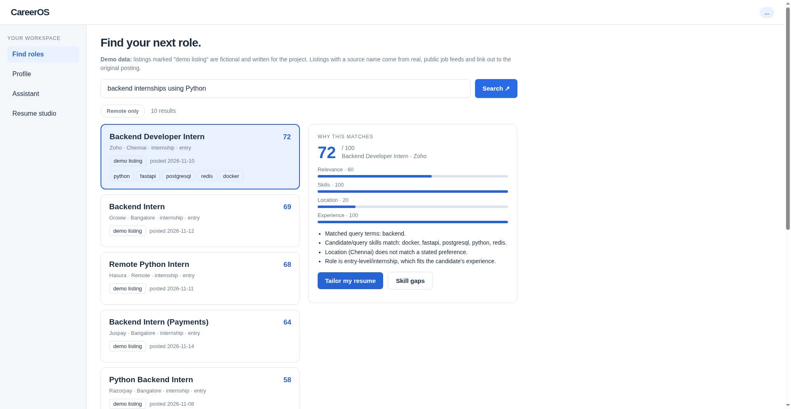
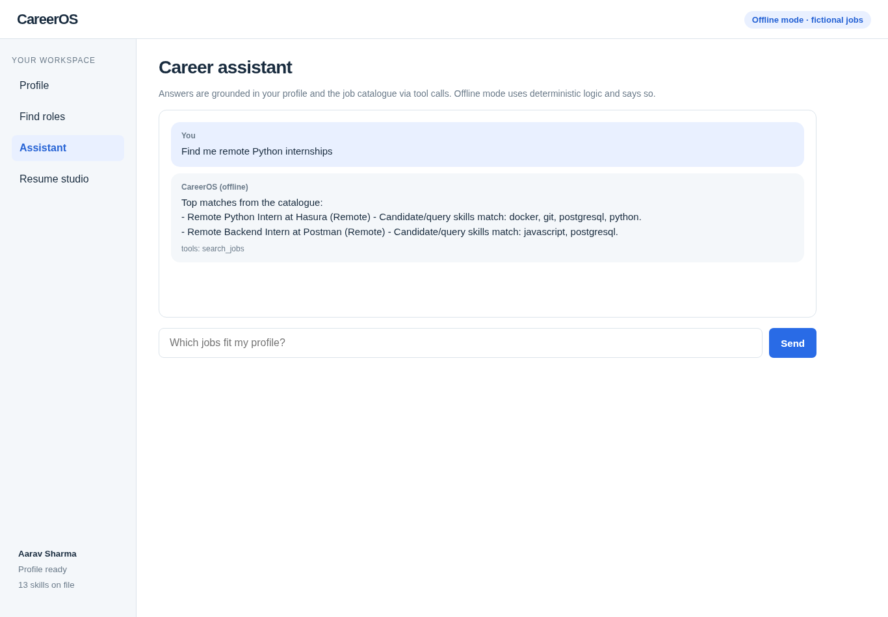
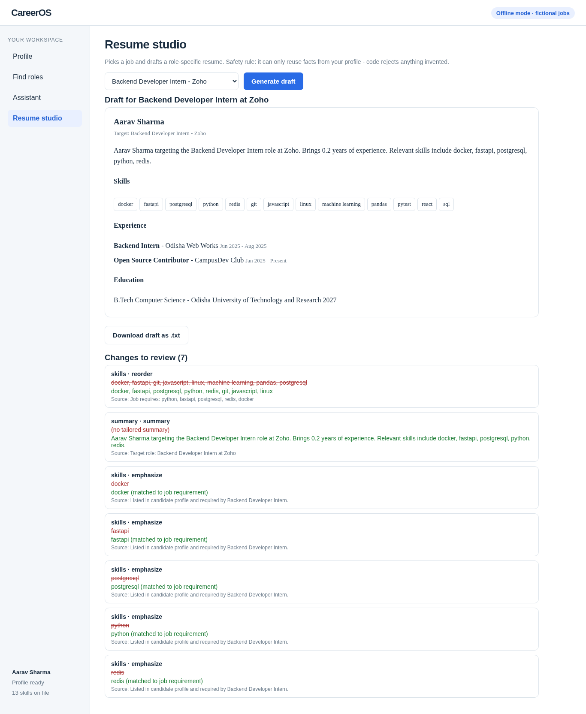

# CareerOS

An AI-powered career assistant, built as a learning project. Upload a resume,
search real job listings in natural language, get explainable recommendations,
chat with a grounded assistant, check your skill gaps against a role, and
generate a tailored resume draft you review before using.

> Learning-project notes are inline across the codebase. This README explains
> what is built, why it is built that way, and what is deliberately left out.

## What it does

1. **Resume parsing** - upload a PDF or TXT resume; the app extracts name,
   skills, experience and education into a structured profile you can correct.
2. **Real job ingestion** - syncs live listings from free, permitted sources:
   Remotive (remote jobs, their API allows sharing with link-back), Arbeitnow
   (free job-board API) and public Greenhouse company boards. Listings carry
   source, posting date and last-verified date; duplicates are merged and
   listings that disappear or go stale are marked expired and hidden.
   A seed CSV of 32 fictional India-focused openings ships for offline demo
   and tests (marked "demo listing" in the UI; they are not real).
3. **Hybrid semantic search** - BM25 keyword scoring + vector similarity from
   real embeddings (all-MiniLM-L6-v2, 384-dim, quantized ONNX - no GPU, no
   API key). Two fusion strategies are implemented (weighted min-max and
   Reciprocal Rank Fusion) and compared in `docs/evaluation.md`.
4. **Explainable ranking** - every result is scored on four components
   (relevance, skills, location, experience) with human-readable reasons.
5. **Grounded assistant** - a LangGraph state machine answers questions using
   only the candidate profile and job data, via bounded tool calls
   (`search_jobs`, `get_candidate_profile`, `analyze_skill_gap`).
6. **Skill-gap analysis** - for any job: which required skills you have,
   which you miss, and a concrete way to close each gap.
7. **Resume tailoring** - builds a role-specific draft and logs every change
   with its source. A code-level validator rejects drafts that invent skills,
   employers or qualifications.

## Live demo

https://careeros-esm5.onrender.com

Hosted on Render's free tier in offline mode (no API key): the assistant and
tailoring use the deterministic fallbacks. Free-tier notes: the service
sleeps after 15 minutes idle (first load can take about a minute to wake),
and uploaded data is ephemeral - it resets on redeploy or restart.

## Screenshots







## Quickstart (5 minutes, no API key needed)

```bash
python -m venv .venv && source .venv/bin/activate
pip install -r requirements.txt
python run.py                          # http://localhost:8000
```

The first run downloads the embedding model (~23 MB from Hugging Face, once).
No network at all? Set `CAREEROS_EMBEDDINGS=off` to use the deterministic
hashing fallback instead.

Demo path:

1. Open http://localhost:8000. A sample candidate profile is preloaded on
   first run; go to **Profile** to see it, and upload
   `sample_data/sample_resume.pdf` (or your own resume) to replace it.
2. Go to **Find roles** and search `backend internships using Python in
   India`. Expand the score breakdown, then click **Skill gaps**.
3. Run `python scripts/fetch_jobs.py` to sync real listings, then search
   again and compare.
4. Go to **Assistant** and ask "Which jobs fit my profile?".
5. Go to **Resume studio**, pick a job, and review the change log.

Run the tests and the ranking evaluation:

```bash
pip install -r requirements-dev.txt
pytest                                   # 44 tests
python scripts/evaluate_ranking.py       # P@5 / R@10 / NDCG@10 vs baselines
```

## Claude integration

The app uses the Anthropic Messages API behind a single service layer
(`app/services/llm.py`). Set `ANTHROPIC_API_KEY` (see `.env.example`) and the
same features use Claude for extraction, tool-use chat and phrasing. The
LangGraph assistant graph is identical in both modes; Claude only swaps the
decision node (via langchain-anthropic).

**Without a key the app runs in OFFLINE mode**: every feature still works
with deterministic local logic, and AI-looking output is labelled `offline`.
This is deliberate - it keeps the demo runnable anywhere and makes the tests
independent of a paid API.

Design rules enforced in code:

- Model output that gets saved is validated against pydantic schemas first;
  invalid output is discarded and the code falls back to deterministic logic.
- The API key never reaches the browser; the frontend only sees `mode`.
- The LLM never does work that SQL, search indexes or plain code do better.

## Architecture

```
app/
  main.py               FastAPI routes + reliability metrics
  config.py             environment-driven settings (DATABASE_URL, LLM_MODE, ...)
  db.py / models.py     SQLAlchemy setup + additive column migrations
  schemas.py            API contracts; also validate Claude output
  services/
    embeddings.py       MiniLM ONNX (384-dim) + hashing fallback, batch-embedded
    retrieval.py        BM25 + vector hybrid; weighted and RRF fusion
    ranking.py          4-component explainable scoring with reasons
    parsing.py          PDF/TXT extraction + heuristic parser (+ Claude path)
    agent_graph.py      assistant as a LangGraph state machine (both modes)
    assistant_tools.py  the bounded tool set the assistant may call
    skillgap.py         profile-vs-job gap analysis with closing advice
    tailor.py           draft builder + no-invention validator
    vectorstore.py      pgvector store (Postgres only); SQLite stays in-Python
    sources/            remotive, arbeitnow, greenhouse boards + sync/dedupe/expiry
    llm.py              the only file that talks to the Anthropic SDK
frontend/               React + Vite SPA (builds into app/static, served by FastAPI)
seed/jobs.csv           32-job fictional demo catalogue (offline fallback)
scripts/                fetch_jobs.py, reindex.py, evaluate_ranking.py
docs/evaluation.md      measured retrieval quality (regenerated by the script)
tests/                  44 tests: parsing, retrieval, ranking, tailoring safety,
                        embeddings, sources sync, skill gaps, agent graph, API flow
```

Data storage defaults to SQLite (zero setup). Set
`DATABASE_URL=postgresql+psycopg2://...` to run on PostgreSQL: the same code
works on both, and on Postgres `vectorstore.py` enables the pgvector
extension and shortlists candidates with SQL-side cosine distance.
`docker-compose.yml` includes an optional `pgvector` profile for local use.

## Engineering decisions worth explaining in an interview

- **Quantized ONNX MiniLM instead of an embedding API.** Real semantic
  similarity (paraphrases match), still free and offline, ~23 MB model,
  no torch - it fits the free host's 512 MB memory limit. Sub-batched
  embedding keeps peak memory flat during bulk ingest. The old hashing
  vectors remain as an explicit fallback, and every row records which model
  wrote it so `scripts/reindex.py` can migrate after an upgrade.
- **Fusion chosen by measurement, not taste.** Weighted min-max and
  Reciprocal Rank Fusion are both implemented; `docs/evaluation.md` shows
  P@5 / R@10 / NDCG@10 for BM25-only, vector-only and both hybrids on a
  labelled query set. Weighted hybrid wins on NDCG@10 today; the harness
  exists so any change has to re-prove itself.
- **Real job data with provenance and expiry.** Every listing knows its
  source, source id, posting date and last-verified date. Sync is
  idempotent: seen listings update their verified date, gone or stale ones
  expire out of search, duplicates merge on normalized title+company+location.
- **Component scoring instead of one opaque rank.** Each component is scored
  separately and contributes a reason string. Weights are constants
  (`ranking.WEIGHTS`), easy to discuss and tune.
- **Safety enforced in code, not in a prompt.** `tailor.validate_draft`
  compares the draft against the profile; the API refuses to save a draft
  that invents anything. A prompt alone cannot guarantee that.
- **The assistant is one graph in both modes.** LangGraph nodes
  (decide -> run_tools -> compose) are the orchestration; offline mode
  exercises the same graph the Claude mode does, so the loop is tested
  without a paid key.

## Known limitations (honest list)

- Offline resume parsing is heuristic; accuracy depends on resume formatting.
  That is why every parsed field is user-correctable, and why the Claude path
  exists. Field-level accuracy has been verified only on the sample resumes
  in `tests/` and `sample_data/`.
- The Claude code paths are written and unit-shaped, but have not been run
  against the live API yet (no key). Everything labelled offline is what
  actually runs in the demo.
- The synced catalogue skews to what the free sources carry (remote and
  international roles); it is not an India-specific job board. The seed set
  covers the India internship demo case with fictional listings.
- Ranking evaluation uses a small, hand-labelled set on the seed catalogue.
  It catches regressions but is not a large-scale benchmark.
- No authentication: it is a single-candidate demo. Profile row id=1.
- On SQLite, vector similarity is computed in Python. Fine at this catalogue
  scale; the Postgres+pgvector path exists for larger ones (verified on
  Postgres; the free demo runs SQLite).
- Ranking weights are hand-chosen constants, now at least checked against
  the evaluation set rather than asserted.
